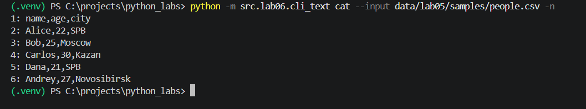
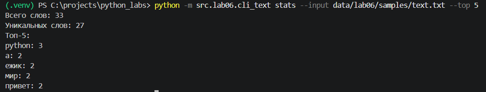
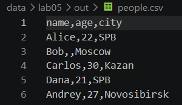
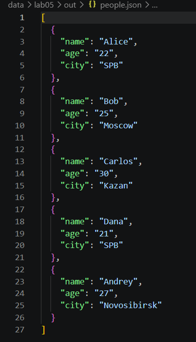
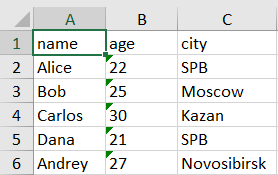
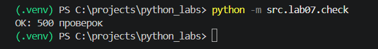
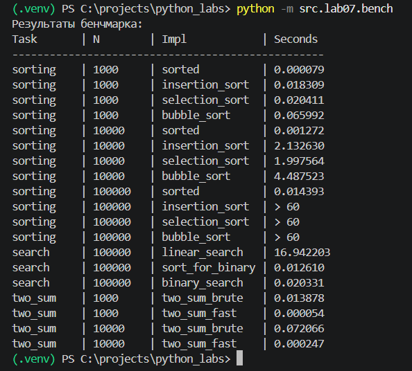

# ЛР6 - CLI-утилиты с argparse (cat/grep-lite + конвертеры)

## Задание A - Текстовые утилиты (cli_text.py)
Модуль создаёт консольную утилиту с двумя подкомандами. `cat --input <путь> [-n]` выводит содержимое файла построчно, а с флагом `-n` добавляет перед каждой строкой её номер. `stats --input <путь> [--top N]` считает частоты слов в файле с помощью функций из ЛР3 (`normalize`, `tokenize`, `count_freq`, `top_n` из `src/lib/text.py`) и печатает общее число слов, число уникальных слов и топ-N самых частых слов (по умолчанию 5). Файл читается функцией `read_text` из ЛР4. Расположен в `src/lab06/cli_text.py`.

```python
import argparse
import sys
from src.lab04.io_txt_csv import read_text
from src.lib.text import normalize, tokenize, count_freq, top_n

def read_input(path: str) -> str:
    """
    Читает текстовый файл (в кодировке UTF-8) и возвращает его содержимое.

    Если файл не найден или не читается как UTF-8 - печатает понятное
    сообщение об ошибке (в stderr) и завершает программу с кодом 1.
    """
    try:
        return read_text(path)
    except FileNotFoundError:
        print(f"Ошибка: файл не найден: {path}", file=sys.stderr)
        sys.exit(1)
    except UnicodeDecodeError:
        print(f"Ошибка: не удалось прочитать файл {path} в кодировке UTF-8", file=sys.stderr)
        sys.exit(1)

def run_cat(args: argparse.Namespace) -> None:
    """
    Подкоманда cat: выводит содержимое файла построчно.
    Если указан флаг -n - перед каждой строкой печатается её номер.
    """
    text = read_input(args.input)

    lines = text.splitlines()

    for number, line in enumerate(lines, start=1):
        if args.n:
            print(f"{number}: {line}")
        else:
            print(line)

def run_stats(args: argparse.Namespace) -> None:
    """
    Подкоманда stats: считает частоты слов в файле (функции из ЛР3)
    и печатает общее число слов, число уникальных слов и топ слов.
    """
    text = read_input(args.input)

    tokens = tokenize(normalize(text))
    freq = count_freq(tokens)

    print(f"Всего слов: {len(tokens)}")
    print(f"Уникальных слов: {len(freq)}")
    print(f"Топ-{args.top}:")
    for word, count in top_n(freq, n=args.top):
        print(f"{word}: {count}")
    
def main() -> None:
    parser = argparse.ArgumentParser(description="CLI-утилиты для работы с текстовыми файлами")
    subparsers = parser.add_subparsers(dest="command", required=True)

    cat_parser = subparsers.add_parser("cat", help="вывести содержимое файла", description="Выводит содержимое файла построчно.")
    cat_parser.add_argument("--input", required=True, help="путь к текстовому файлу")
    cat_parser.add_argument("-n", action="store_true", help="нумеровать строки")

    stats_parser = subparsers.add_parser("stats", help="частоты слов в тексте", description="Считает частоты слов в тексте и выводит самые частые.")
    stats_parser.add_argument("--input", required=True, help="путь к текстовому файлу")
    stats_parser.add_argument("--top", type=int, default=5, help="сколько слов показать (по умолчанию 5)")

    args = parser.parse_args()

    if args.command == "cat":
        run_cat(args)
    elif args.command == "stats":
        if args.top <= 0:
            parser.error("--top должен быть положительным числом")
        run_stats(args)

if __name__ == "__main__":
    main()
```

### Проверка:

people.csv
```
name,age,city
Alice,22,SPB
Bob,25,Moscow
Carlos,30,Kazan
Dana,21,SPB
Andrey,27,Novosibirsk
```



stats.txt
```
Привет, мир! Привет, Python!
Python - простой язык, а мир программирования большой.
Мы изучаем Python, чтобы писать простые программы.
По-настоящему интересно, когда программа работает.
Ёлка и ёжик живут в лесу, а ежик любит ёлку.
```


---

## Задание B - Конвертеры (cli_convert.py)
Модуль создаёт консольную утилиту с тремя подкомандами: `json2csv`, `csv2json` и `csv2xlsx`. У каждой два обязательных параметра: `--in` (входной файл) и `--out` (выходной файл). Подкоманды вызывают функции из ЛР5 (`json_to_csv`, `csv_to_json`, `csv_to_xlsx`). Расположен в `src/lab06/cli_convert.py`.

```python
import argparse
import json
import sys
from src.lab05.json_csv import json_to_csv, csv_to_json
from src.lab05.csv_xlsx import csv_to_xlsx

def main() -> None:
    parser = argparse.ArgumentParser(description="Конвертеры данных JSON / CSV / XLSX")
    sub = parser.add_subparsers(dest="command", required=True)

    p1 = sub.add_parser("json2csv", help="преобразовать JSON в CSV", description="Преобразует JSON в CSV.")
    p1.add_argument("--in", dest="input", required=True, help="входной .json файл")
    p1.add_argument("--out", dest="output", required=True, help="выходной .csv файл")

    p2 = sub.add_parser("csv2json", help="преобразовать CSV в JSON", description="Преобразует CSV в JSON.")
    p2.add_argument("--in", dest="input", required=True, help="входной .csv файл")
    p2.add_argument("--out", dest="output", required=True, help="выходной .json файл")

    p3 = sub.add_parser("csv2xlsx", help="преобразовать CSV в XLSX", description="Преобразует CSV в файл Excel.")
    p3.add_argument("--in", dest="input", required=True, help="входной .csv файл")
    p3.add_argument("--out", dest="output", required=True, help="выходной .xlsx файл")

    args = parser.parse_args()

    try:
        if args.command == "json2csv":
            json_to_csv(args.input, args.output)
        elif args.command == "csv2json":
            csv_to_json(args.input, args.output)
        elif args.command == "csv2xlsx":
            csv_to_xlsx(args.input, args.output)
    except FileNotFoundError:
        print(f"Ошибка: файл не найден: {args.input}", file=sys.stderr)
        sys.exit(1)
    except json.JSONDecodeError:
        print(f"Ошибка: некорректный JSON", file=sys.stderr)
        sys.exit(1)
    except ValueError as error:
        print(f"Ошибка: {error}", file=sys.stderr)
        sys.exit(1)

if __name__ == "__main__":
    main()
```

```powershell
python -m src.lab06.cli_convert json2csv --in data/lab05/samples/people.json --out data/lab05/out/people.csv
python -m src.lab06.cli_convert csv2json --in data/lab05/samples/people.csv --out data/lab05/out/people.json
python -m src.lab06.cli_convert csv2xlsx --in data/lab05/samples/people.csv --out data/lab05/out/people.xlsx
```







---

## Способ запуска

Запуск выполняется из **корня репозитория** (там, где лежит папка `src/`), с помощью флага `-m`:

```powershell
python -m src.lab06.cli_text <подкоманда> [параметры]
python -m src.lab06.cli_convert <подкоманда> [параметры]
```
---

### Справка --help

Справка работает и для самой утилиты, и для каждой подкоманды, например:

```
python -m src.lab06.cli_text --help
usage: python.exe -m src.lab06.cli_text.py [-h] {cat,stats} ...

CLI-утилиты для работы с текстовыми файлами

positional arguments:
  {cat,stats}
    cat        вывести содержимое файла
    stats      частоты слов в тексте

options:
  -h, --help   show this help message and exit
```

---


# ЛР7 - Поиск, сортировка и измерение времени

## Задание A - Поиск (search.py)
Модуль содержит четыре функции. `linear_search(nums, x)` идёт по списку и возвращает индекс первого вхождения `x` или `-1`. `binary_search(sorted_nums, x)` работает только на **уже отсортированном** списке: цикл `while lo <= hi`, на каждом шаге сравниваем `x` со средним элементом и отбрасываем половину, где `x` быть не может; на неотсортированном списке результат не определён (это записано в докстринге). `two_sum_brute(nums, target)` перебирает все пары индексов `i < j` двумя вложенными циклами и возвращает первую пару с нужной суммой или `None` (порядка `n * n` шагов). `two_sum_fast(nums, target)` делает один проход и хранит в словаре «значение -> индекс» всё, что уже видела: для каждого числа проверяет, есть ли в словаре `target - число` (порядка `n` шагов). Расположен в `src/lab07/search.py`.

```python
def linear_search(nums, x) -> int:
    """Индекс первого вхождения x или -1.
 
    linear_search([4, 2, 7, 2], 2) -> 1
    linear_search([4, 2, 7, 2], 9) -> -1
    linear_search([], 1) -> -1
    """
    for i in range(len(nums)):
        if nums[i] == x:
            return i
    return -1

def binary_search(sorted_nums, x) -> int:
    """Индекс x в отсортированном по возрастанию списке или -1.
    На неотсортированном списке результат не определён.
 
    binary_search([1, 3, 5, 7], 5) -> 2
    binary_search([1, 3, 5, 7], 4) -> -1
    binary_search([5], 5) -> 0
    binary_search([], 5) -> -1
    """
    lo = 0
    hi = len(sorted_nums) - 1
    while lo <= hi:
        mid = (lo + hi) // 2
        if x == sorted_nums[mid]:
            return mid
        elif x < sorted_nums[mid]:
            hi = mid - 1
        else:
            lo = mid + 1
    return -1

def two_sum_brute(nums, target) -> tuple[int, int] | None:
    """Пара индексов (i, j), i < j, nums[i] + nums[j] == target, или None.
 
    two_sum_brute([2, 7, 11, 15], 9) -> (0, 1)
    two_sum_brute([1, 2], 10) -> None
    """
    for i in range(len(nums) - 1):
        for j in range(i + 1, len(nums)):
            if nums[i] + nums[j] == target:
                return (i, j)
    return None

def two_sum_fast(nums, target) -> tuple[int, int] | None:
    """То же, что two_sum_brute, но за один проход со словарём."""
    seen = {}
    for i in range(len(nums)):
        if nums[i] in seen:
            return (seen[nums[i]], i)
        else:
            seen[target - nums[i]] = i
    return None
```

## Задание B - Сортировки (sorting.py)
Три квадратичные сортировки: `bubble_sort` (пузырёк: соседи меняются местами, максимум «всплывает» в конец; добавлен флаг `swapped` для раннего выхода, если за проход обменов не было), `insertion_sort` (вставки: очередной элемент сдвигается влево до своего места) и `selection_sort` (выбор: минимум оставшейся части ставится на место). Каждая начинает с копии списка (`a = list(nums)`) и **возвращает новый список**: исходный не меняется. Готовые `sorted`, `.sort()`, `min` и `max` внутри не используются. Расположен в `src/lab07/sorting.py`.

```python
def bubble_sort(nums) -> list[int]:
    """Новый список, отсортированный по возрастанию. Исходный не меняется.
 
    bubble_sort([3, 1, 2]) -> [1, 2, 3]
    bubble_sort([2, 2, 1]) -> [1, 2, 2]
    bubble_sort([]) -> []
    """
    a = list(nums)
    n = len(a)
    for i in range(n):
        swapped = False
        for j in range(0, n - i - 1):
            if a[j] > a[j + 1]:
                a[j], a[j + 1] = a[j + 1], a[j]
                swapped = True 
        if not swapped:
            break
    return a

def insertion_sort(nums: list[int]) -> list[int]:
    """Сортирует список методом вставок.
    Создает и возвращает новый отсортированный список, не изменяя исходный.
    Принимает исходный список чисел, возвращает новый отсортированный список.
    """
    a = list(nums)
    for i in range(1, len(a)):
        key = a[i]
        j = i - 1
        while j >= 0 and a[j] > key:
            a[j + 1] = a[j]
            j -= 1
        a[j + 1] = key
    return a

def selection_sort(nums: list[int]) -> list[int]:
    """Сортирует список методом выбора.
    Создает и возвращает новый отсортированный список, не изменяя исходный.
    Принимает исходный список чисел, возвращает новый отсортированный список.
    """
    a = list(nums)
    n = len(a)
    for i in range(n):
        min_idx = i
        for j in range(i + 1, n):
            if a[j] < a[min_idx]:
                min_idx = j
        a[i], a[min_idx] = a[min_idx], a[i]
    return a

```

## Задание C - Проверка против эталона (check.py)
Модуль сравнивает написанные функции с эталоном на случайных данных. `check_sorting(fn, trials=100)` сравнивает `fn(nums)` со `sorted(nums)` и проверяет, что исходный список не изменился. `check_search()` сравнивает `linear_search` с `list.index` (ошибка `ValueError` у `index` соответствует `-1`), а `binary_search` проверяет на отсортированных списках, включая `x`, которого нет в списке (при повторах проверяется не сам индекс, а то, что по нему лежит `x`). `check_two_sum(trials=100)` сравнивает `two_sum_brute` и `two_sum_fast` между собой и проверяет, что сумма элементов по найденным индексам равна `target`. Списки случайные: длина 0-50, значения с повторами и отрицательные. При расхождении поднимается `AssertionError` с данными, на которых оно случилось. Расположен в `src/lab07/check.py`.

```python
import random
from src.lab07.search import linear_search, binary_search, two_sum_brute, two_sum_fast
from src.lab07.sorting import bubble_sort, insertion_sort, selection_sort

def check_sorting(fn, trials: int = 100) -> int:
    """
    Проверяет функцию сортировки на случайных данных против эталонного sorted().
    Принимает функцию сортировки для проверки и количество испытаний (по умолчанию 100).
    Возвращает количество успешно пройденных тестов.
    """
    for _ in range(trials):
        n = random.randint(0, 50)
        nums = [random.randint(-100, 100) for _ in range(n)]
        original = list(nums)
        result = fn(nums)
        assert result == sorted(nums), f"{fn.__name__} ошиблась на {nums}: получено {result}, ожидалось {sorted(nums)}"
        assert nums == original, f"{fn.__name__} изменила исходный список"
    return trials

def check_search() -> int:
    """
    Проверяет функции linear_search и binary_search на случайных данных.
    Возвращает количество успешно пройденных испытаний.
    """
    trials = 100
    for _ in range(trials):
        n = random.randint(0, 50)
        nums = [random.randint(-50, 50) for _ in range(n)]
        x = random.randint(-60, 60)
        
        try:
            expected_lin = nums.index(x)
        except ValueError:
            expected_lin = -1
        actual_lin = linear_search(nums, x)
        assert actual_lin == expected_lin, f"linear_search ошиблась для поиска {x} в {nums}: получено {actual_lin}, ожидалось {expected_lin}"

        sorted_nums = sorted(nums)
        try:
            expected_bin = sorted_nums.index(x)
        except ValueError:
            expected_bin = -1
        actual_bin = binary_search(sorted_nums, x)
        if expected_bin == -1:
            assert actual_bin == -1, f"binary_search не нашла элемент, которого нет: {x} в {sorted_nums}"
        else:
            assert actual_bin != -1 and sorted_nums[actual_bin] == x, f"binary_search вернула некорректный индекс {actual_bin} для {x} в {sorted_nums}"
    return trials

def check_two_sum(trials: int = 100) -> int:
    """
    Проверяет эквивалентность результатов two_sum_brute и two_sum_fast.
    Принимает количество испытаний (по умолчанию 100).
    Возвращает количество успешно пройденных тестов.
    """
    for _ in range(trials):
        n = random.randint(2, 30)
        nums = [random.randint(-50, 50) for _ in range(n)]
        if random.random() > 0.3 and n >= 2:
            i, j = random.sample(range(n), 2)
            target = nums[i] + nums[j]
        else:
            target = random.randint(-200, 200)

        res_brute = two_sum_brute(nums, target)
        res_fast = two_sum_fast(nums, target)

        if res_brute is None:
            assert res_fast is None, f"two_sum_brute нашла None, а fast нашла {res_fast} для nums={nums}, target={target}"
        else:
            bi, bj = res_brute
            assert nums[bi] + nums[bj] == target, f"two_sum_brute вернула неверные индексы {res_brute}"
            assert res_fast is not None, f"two_sum_brute нашла пару, а fast вернула None"
            fi, fj = res_fast
            assert nums[fi] + nums[fj] == target, f"two_sum_fast вернула неверные индексы {res_fast}"
    return trials

if __name__ == "__main__":
    random.seed(42)
    total = 0
    for fn in (bubble_sort, insertion_sort, selection_sort):
        total += check_sorting(fn)
    total += check_search()
    total += check_two_sum()
    print(f"OK: {total} проверок")
```



## Задание D - Бенчмарк (bench.py)
Модуль измеряет время через `timeit` и печатает таблицу в консоль, а также сохраняет её в `data/lab07/bench.csv` (колонки `task,n,impl,seconds`) через `write_csv` из ЛР4. Измеряются: `sorted` и три свои сортировки на `n = 1 000 / 10 000 / 100 000`; линейный и бинарный поиск (10 000 запросов к отсортированному списку из 100 000 элементов); `two_sum_brute` и `two_sum_fast` на `n = 1 000 / 10 000`. Все алгоритмы получают одни и те же данные (`random.seed(42)`). Расположен в `src/lab07/bench.py`.

```python
import random
import timeit
from src.lab04.io_txt_csv import write_csv
from src.lab07.sorting import bubble_sort, insertion_sort, selection_sort
from src.lab07.search import linear_search, binary_search, two_sum_brute, two_sum_fast

def main() -> None:
    """Запускает бенчмарки всех алгоритмов, выводит сводную таблицу в консоль и сохраняет её в CSV."""
    random.seed(42)
    csv_rows: list[tuple[str, int, str, str]] = []
    
    sizes = [1_000, 10_000, 100_000]
    for n in sizes:
        data = [random.randint(-1_000_000, 1_000_000) for _ in range(n)]
        
        t = timeit.timeit(lambda: sorted(data), number=1)
        csv_rows.append(("sorting", n, "sorted", f"{t:.6f}"))
        
        for name, fn in [("insertion_sort", insertion_sort), ("selection_sort", selection_sort), ("bubble_sort", bubble_sort)]:
            if n <= 10_000:
                t = timeit.timeit(lambda: fn(data), number=1)
                csv_rows.append(("sorting", n, name, f"{t:.6f}"))
            else:
                csv_rows.append(("sorting", n, name, "> 60"))

    search_data_size = 100_000
    search_queries_count = 10_000
    search_list = [random.randint(-1_000_000, 1_000_000) for _ in range(search_data_size)]
    queries = [random.choice(search_list) for _ in range(search_queries_count)]
    
    t = timeit.timeit(lambda: [linear_search(search_list, q) for q in queries], number=1)
    csv_rows.append(("search", search_data_size, "linear_search", f"{t:.6f}"))

    t = timeit.timeit(lambda: sorted(search_list), number=1)
    csv_rows.append(("search", search_data_size, "sort_for_binary", f"{t:.6f}"))

    search_list = sorted([random.randint(-1_000_000, 1_000_000) for _ in range(search_data_size)])

    t = timeit.timeit(lambda: [binary_search(search_list, q) for q in queries], number=1)
    csv_rows.append(("search", search_data_size, "binary_search", f"{t:.6f}"))

    for n in [1_000, 10_000]:
        ts_data = [random.randint(-1_000_000, 1_000_000) for _ in range(n)]
        i, j = random.sample(range(n), 2)
        target = ts_data[i] + ts_data[j]

        t = timeit.timeit(lambda: two_sum_brute(ts_data, target), number=1)
        csv_rows.append(("two_sum", n, "two_sum_brute", f"{t:.6f}"))

        t = timeit.timeit(lambda: two_sum_fast(ts_data, target), number=1)
        csv_rows.append(("two_sum", n, "two_sum_fast", f"{t:.6f}"))

    header = ("task", "n", "impl", "seconds")
    write_csv(csv_rows, "data/lab07/bench.csv", header=header)

    print("Результаты бенчмарка:")
    print(f"{'Task':<10} | {'N':<8} | {'Impl':<15} | {'Seconds':<10}")
    print("-" * 50)
    for task, n, impl, seconds in csv_rows:
        print(f"{task:<10} | {n:<8} | {impl:<15} | {seconds:<10}")

if __name__ == "__main__":
    main()
```



---

## Таблица бенчмарка

Таблица взята из `data/lab07/bench.csv`. Время в секундах. Каждый замер - один запуск (`timeit.timeit(..., number=1)`). Значение `> 60` означает, что алгоритм не запускался.

```
task,n,impl,seconds
sorting,1000,sorted,0.000079
sorting,1000,insertion_sort,0.018309
sorting,1000,selection_sort,0.020411
sorting,1000,bubble_sort,0.065992
sorting,10000,sorted,0.001272
sorting,10000,insertion_sort,2.132630
sorting,10000,selection_sort,1.997564
sorting,10000,bubble_sort,4.487523
sorting,100000,sorted,0.014393
sorting,100000,insertion_sort,> 60
sorting,100000,selection_sort,> 60
sorting,100000,bubble_sort,> 60
search,100000,linear_search,16.942203
search,100000,sort_for_binary,0.012610
search,100000,binary_search,0.020331
two_sum,1000,two_sum_brute,0.013878
two_sum,1000,two_sum_fast,0.000054
two_sum,10000,two_sum_brute,0.072066
two_sum,10000,two_sum_fast,0.000247
```

## Выводы по работе

### Анализ скорости сортировок и поиска
Замеры четко показывают квадратичную зависимость для пузырька, вставок и выбора. Когда мы увеличиваем размер списка в 10 раз (с 1000 до 10000), время работы пузырьковой сортировки увеличивается сразу в 100 раз. Это полностью совпадает с теорией O(n²). Встроенный sorted при этом работает по логике n log n и замедляется всего в 12 раз, легко справляясь даже со 100 000 элементов за сотые доли секунды.

С поиском ситуация похожая. Сам по себе бинарный поиск работает мгновенно. Но без готовой сортировки он бесполезен, т.к. опирается на то, что элементы до m меньше arr[m], а после - больше. Отсюда вывод: сортировать массив ради одного-двух поисков нет смысла, лучше использовать обычный линейный перебор. Бинарный поиск окупается только тогда, когда база данных сортируется один раз, а запросов к ней много. В задаче Two Sum использование словаря вместо вложенных циклов дало огромный прирост.

## Результат check.py

```powershell
python -m src.lab07.check
```

```
OK: 500 проверок
```

Состав: 3 сортировки * 100 случайных списков = 300, поиск (линейный и бинарный на одном и том же списке) = 100, Two Sum (перебор и словарь на одних данных) = 100, всего 500 проверок. Расхождений с эталоном не было, исправлять реализации не пришлось. Для воспроизводимости задано `random.seed(42)`.

