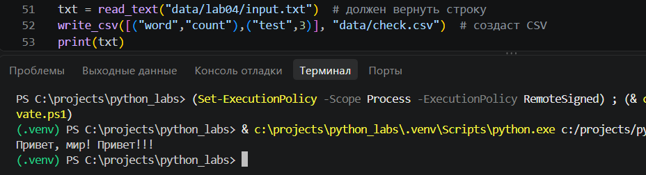
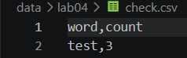
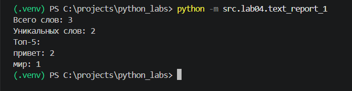
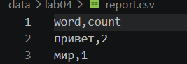
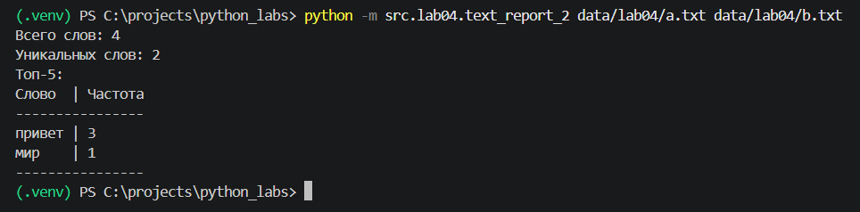
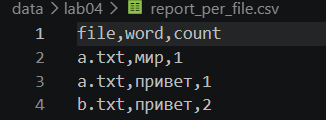
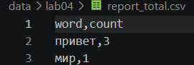

# Лабораторная работа №4 - Файлы: TXT/CSV и отчёты по текстовой статистике

## Задание A

### `read_text`

```Python
from pathlib import Path

def read_text(path: str | Path, encoding: str = "utf-8") -> str:
    """
    Читает текстовый файл целиком и возвращает его содержимое
    как одну строку.

    По умолчанию файл читается в кодировке UTF-8. Если нужен другой
    формат кодировки, можно передать его явно, например:
        read_text("data/input.txt", encoding="cp1251")

    Если файл не найден - функция не перехватывает ошибку,
    а даёт ей "всплыть" наружу как FileNotFoundError.
    Если кодировка не подходит к содержимому файла - аналогично
    всплывает UnicodeDecodeError.

    Если файл пустой - возвращается пустая строка "".
    """
    p = Path(path)
    # FileNotFoundError и UnicodeDecodeError пусть «всплывают» — это нормально
    return p.read_text(encoding=encoding)
```

1. Принимает путь к файлу и преобразует его в объект класса `Path` для работы.
2. Вызывает встроенный метод `.read_text()`, который открывает файл, декодирует его в указанной кодировке и полностью считывает в оперативную память в виде единой строки.
3. Ошибки отсутствия файла (`FileNotFoundError`) или несовпадения кодировки (`UnicodeDecodeError`) намеренно не перехватываются, позволяя им «всплывать» в вызывающий скрипт.

---

### `write_csv`

```Python
import csv
from pathlib import Path
from typing import Iterable, Sequence

def ensure_parent_dir(path: str | Path) -> None:
    """Создать родительские директории для path, если их ещё нет."""
    Path(path).parent.mkdir(parents=True, exist_ok=True)

def write_csv(rows: Iterable[Sequence], path: str | Path, header: tuple[str, ...] | None = None) -> None:
    """
    Записать строки в CSV (разделитель ','). Перезаписывает файл.
    Если передан header — он записывается первой строкой.
    Все строки должны иметь одинаковую длину, иначе ValueError.
    """
    rows = list(rows)
    ensure_parent_dir(path)
    p = Path(path)
    length = {len(i) for i in rows}
    if header is not None:
        length.add(len(header))
    if len(length) > 1:
        raise ValueError("Все строки должны иметь одинаковую длину")
    with p.open("w", newline="", encoding="utf-8") as f:
        w = csv.writer(f)
        if header is not None:
            w.writerow(header)
        for r in rows:
            w.writerow(r)
```
1. `ensure_parent_dir` извлекает путь к содержащей папке целевого файла с помощью свойства `.parent`. Создает эту директорию методом `.mkdir()`. Флаг `parents=True` отвечает за рекурсивное создание вложенных папок, а `exist_ok=True` игнорирует ошибку, если папка уже существует.
2. `write_csv` принудительно конвертирует итерируемый объект строк в список `list(rows)` для фиксации данных в памяти.
3. Проверяет «прямоугольность» структуры: через генераторное множество собирает длины всех строк данных, а также длину заголовка `header` (если он передан). Если в множестве `lengths` оказывается больше одного значения, возбуждается исключение `ValueError`.
4. Вызывает функцию `ensure_parent_dir()` для гарантированного создания всех промежуточных папок перед сохранением.
5. Открывает файл через `p.open()` в режиме записи с параметром `newline=""`, предотвращающим появление пустых строк на Windows.
6. Инициализирует объект `csv.writer()`, записывает заголовок (при наличии), после чего в цикле `for` последовательно вносит в файл каждую строку данных.





---

## Задание B

```Python
from src.lib.text import normalize, tokenize, count_freq, top_n
from src.lab04.io_txt_csv import read_text, write_csv
import sys

def main():
    try:
        raw_text = read_text("data/lab04/input.txt", encoding="utf-8")
    except FileNotFoundError:
        print("Ошибка: файл не найден")
        return
    norm = normalize(raw_text)
    words = tokenize(norm)
    unique_words = count_freq(words)
    all_rows = sorted(unique_words.items(), key=lambda x: (-x[1], x[0]))
    top_5 = top_n(unique_words)
    write_csv(all_rows, "data/lab04/report.csv", header=("word", "count"))
    print(f"Всего слов: {len(words)}")
    print(f"Уникальных слов: {len(unique_words)}")
    print("Топ-5:")
    for i in top_5:
        print(f"{i[0]}: {i[1]}")

if __name__ == "__main__":
    main()
```

1. Скрипт пытается прочесть входной файл `input.txt` через функцию `read_text()`. Процесс обернут в блок `try-except`: при отсутствии файла выводится сообщение `Ошибка: файл не найден` и выполнение функции завершается через `return`.
2. Успешно прочитанная строка передается в функцию `normalize()` для приведения к единому регистру, замены `ё` на `е` и очистки от лишних спецсимволов. Результат сразу передается в `tokenize()` для разбиения текста на список слов-токенов.
3. Функция `count_freq()` собирает токены в частотный словарь. Общее количество слов вычисляется как длина списка токенов (`len(word)`), а число уникальных — как размер словаря (`len(unique_words)`).
4. Метод `unique_words.items()` превращает словарь в список пар `(слово, частота)`. Функция `sorted()` упорядочивает их по ключу `lambda x: (-x[1], x[0])`.
5. Функция `top_n()` извлекает 5 самых частотных элементов для последующего вывода.
6. Отсортированный массив `all_rows` передается в функцию `write_csv()`, которая записывает его на диск по пути `report.csv` вместе с заголовком столбцов `("word", "count")`.
7. В терминал через f-строки выводятся итоговые числовые метрики и список топ-слов в цикле `for`.





---

## Задание со звёздочкой

```Python
from src.lib.text import normalize, tokenize, count_freq, top_n
from src.lab04.io_txt_csv import read_text, write_csv
import sys
from pathlib import Path

def main():
    raw_text_full = sorted(sys.argv[1:])
    raw_text_all  = ""
    per_file = []
    for i in range(len(raw_text_full)):
        try:
            raw_text = read_text(raw_text_full[i], encoding="utf-8")
        except FileNotFoundError:
            print("Ошибка: файл не найден")
            return
        raw_text_all = raw_text_all + " " + raw_text
        norm = normalize(raw_text)
        worlds = tokenize(norm)
        unique_worls = count_freq(worlds)
        sort_freq = sorted(unique_worls.items(), key=lambda x: (-x[1],x[0]))
        for w,c in sort_freq:
            per_file.append((Path(raw_text_full[i]).name,w,c))
    write_csv(per_file, "data/lab04/report_per_file.csv", header=("file","word", "count"))
    norm = normalize(raw_text_all)
    worlds = tokenize(norm)
    unique_worls = count_freq(worlds)
    top_5 = top_n(unique_worls)
    write_csv(top_5, "data/lab04/report_total.csv", header=("word", "count"))

    max_len = max([len(i[0]) for i in top_5])
    print(f"Всего слов: {len(worlds)}")
    print(f"Уникальных слов: {len(unique_worls)}")
    print("Топ-5:")
    if max_len > 5:
        print("Слово"+" "*(max_len - 4)+"|"+" Частота")
        print("-"*(10 + max_len))
        for i in top_5:
            print(f"{i[0]:<{max_len}} | {i[1]}")
        print("-"*(10 + max_len))
    else:
       print("Слово | Частота")
       print("-"*15)
       for i in top_5:
            print(f"{i[0]:<{max_len}} | {i[1]}")
       print("-"*(10 + max_len))

if __name__ == "__main__":
    main()
```







---

## Политика обработки краевых ситуаций и ошибок

*   **Отсутствие входного файла (`FileNotFoundError`):** Если указанный файл по заданному пути не существует, программа прерывает выполнение, выводит в консоль понятное сообщение об ошибке вида `[Ошибка]: Файл не найден` и завершает работу с кодом.
*   **Сбой декодирования (`UnicodeDecodeError`):** Если кодировка файла не соответствует заданной (например, попытка прочесть файл `cp1251` как `utf-8`), программа безопасно завершается с уведомлением пользователя о необходимости явного указания параметра `--encoding`.
*   **Обработка пустого файла:** При передаче абсолютно пустого файла программа не падает. В консоли выводится статистика о нулевом количестве слов, а в результирующем CSV-файле сохраняется **строка заголовка (`word,count`)** без контента.
*   **Большие файлы:** Настоящее ТЗ подразумевает полное считывание файла в оперативную память как одной строки. При обработке терабайтных логов в реальных условиях рекомендуется модифицировать логику чтения на построчный или блочный стриминг.
*   **Валидация CSV-строк:** В модуле `io_txt_csv.py` встроена проверка структуры данных. Если переданный двумерный массив содержит строки разной длины, вызывается исключение `ValueError`.

---

## Способ запуска `text_report_1.py`

Запуск выполняется из корня репозитория (там, где лежит папка `src/`), с помощью флага `-m`:

```python
python -m src.lab04.text_report_1
```

---

## Способ запуска `text_report_2.py`

Запуск выполняется из корня репозитория (там, где лежит папка `src/`), с помощью флага `-m`:

```python
python -m src.lab04.text_report_2 data/lab04/a.txt data/lab04/b.txt
```

---


# Лабораторная работа №5 - JSON и конвертации (JSON↔CSV, CSV→XLSX)

## Структура лабораторной работы

- `src/lab05/json_csv.py` — преобразование JSON в CSV и CSV в JSON;
- `src/lab05/csv_xlsx.py` — преобразование CSV в XLSX.

Входные примеры находятся в каталоге `data/lab05/samples/`, а результаты
конвертаций — в каталоге `data/lab05/out/`.

## Задание A — JSON ↔ CSV

### Функция `json_to_csv`

```python
from pathlib import Path
import json
import csv

from src.lab04.io_txt_csv import ensure_parent_dir

def json_to_csv(json_path: str, csv_path: str) -> None:
    """
    Преобразует JSON-файл в CSV.
    Поддерживает список словарей [{...}, {...}], заполняет отсутствующие поля пустыми строками.
    Кодировка UTF-8. Порядок колонок — как в первом объекте.
    """
    json_file = Path(json_path)
    csv_file = Path(csv_path)
    if not json_file.exists():
        raise FileNotFoundError("Файл не найден")
    if json_file.suffix.lower() != ".json":
        raise ValueError(f"Неверный формат входного файла: ожидается .json")
    if csv_file.suffix.lower() != ".csv":
        raise ValueError(f"Неверный формат выходного файла: ожидается .csv")
    
    with json_file.open('r', encoding='utf-8') as p:
        try:
            data = json.load(p)
        except json.JSONDecodeError:
            raise ValueError("Пустой JSON или неподдерживаемая структура")
        
    if not isinstance(data, list) or len(data) == 0:
        raise ValueError('Файл JSON пустой или имеет неправильный формат')
    if not all(isinstance(item, dict) for item in data):
        raise ValueError("Все элементы списка JSON должны быть словарями")
    
    ensure_parent_dir(csv_file)
    fieldnames = {}
    for element in data:
        for key in element.keys():
            fieldnames[key] = None
    with csv_file.open('w', newline="", encoding='utf-8') as f:
        w = csv.DictWriter(f, fieldnames=list(fieldnames.keys()))
        w.writeheader()
        w.writerows(data)
```

Функция:

1. Проверяет существование входного файла;
2. Проверяет расширение `.json` и `.csv`;
3. Читает JSON в кодировке UTF-8;
4. Проверяет, что корневой объект является непустым списком словарей;
5. Собирает названия всех ключей в порядке их первого появления;
6. Записывает заголовок и строки в CSV в кодировке UTF-8.

Если в одном из словарей отсутствует ключ, `csv.DictWriter` записывает в
соответствующую ячейку пустое значение.

Пример вызова:

```python
json_to_csv(
    "data/lab05/samples/people.json",
    "data/lab05/out/people_from_json.csv",
)
```


---

### Функция `csv_to_json`

```python
from pathlib import Path
import json
import csv

from src.lab04.io_txt_csv import ensure_parent_dir

def csv_to_json(csv_path: str, json_path: str) -> None:
    """
    Преобразует CSV в JSON (список словарей).
    Заголовок обязателен, значения сохраняются как строки.
    json.dump(..., ensure_ascii=False, indent=2)
    """
    json_file = Path(json_path)
    csv_file = Path(csv_path)
    if not csv_file.exists():
        raise FileNotFoundError("Файл не найден")
    if json_file.suffix.lower() != ".json":
        raise ValueError(f"Неверный формат входного файла: ожидается .json")
    if csv_file.suffix.lower() != ".csv":
        raise ValueError(f"Неверный формат выходного файла: ожидается .csv")
    
    with csv_file.open("r", newline="", encoding="utf-8") as f:
        reader = csv.DictReader(f)
        if reader.fieldnames is None:
            raise ValueError("Файл CSV не содержит заголовок")
        data = list(reader)
    if not data:
        raise ValueError("Файл CSV не содержит данных")
    ensure_parent_dir(json_file)

    with json_file.open("w", encoding="utf-8") as f:
        json.dump(data, f, ensure_ascii=False, indent=2)
```

Функция:

1. Проверяет существование входного файла;
2. Проверяет расширение `.csv` и `.json`;
3. Читает CSV в кодировке UTF-8;
4. Проверяет наличие заголовка и хотя бы одной строки данных;
5. Преобразует каждую строку в словарь;
6. Сохраняет список словарей в JSON с отступом в два пробела.

Пример вызова:

```python
csv_to_json(
    "data/lab05/samples/people.csv",
    "data/lab05/out/people_from_csv.json",
)
```


### Запуск модуля JSON ↔ CSV

Из корня репозитория:

```powershell
python -m src.lab05.json_csv
```

При таком запуске создаются:

- `data/lab05/out/people_from_csv.json`;
- `data/lab05/out/people_from_json.csv`;
- `data/lab05/out/cities_from_csv.json`;
- `data/lab05/out/cities_from_json.csv`.

---

## Задание B — CSV → XLSX

Модуль [csv_xlsx.py](./csv_xlsx.py) содержит функцию:

```python
import csv
from pathlib import Path
from openpyxl import Workbook
from openpyxl.utils import get_column_letter
from src.lab04.io_txt_csv import ensure_parent_dir

def csv_to_xlsx(csv_path: str, xlsx_path: str) -> None:
    """
    Конвертирует CSV в XLSX.
    Использует openpyxl.
    Первая строка CSV — заголовок.
    Лист называется "Sheet1".
    Колонки — автоширина по длине текста (не менее 8 символов).
    """
    src = Path(csv_path)
    dst = Path(xlsx_path)
    if src.suffix.lower() != ".csv":
        raise ValueError(f"Неверный тип файла: ожидается .csv, получено '{src.suffix}'")
    if dst.suffix.lower() != ".xlsx":
        raise ValueError(f"Неверный тип файла: ожидается .xlsx, получено '{dst.suffix}'")
    if not src.exists():
        raise FileNotFoundError("Указанный CSV файл не найден")

    with src.open('r', newline='', encoding='utf-8') as f:
        reader = list(csv.reader(f))
    if not reader:
        raise ValueError("Файл CSV пустой")

    widths = {}
    for row in reader:
        for index, cell in enumerate(row):
            if len(cell) > widths.get(index, 0):
                widths[index] = len(cell)

    wb = Workbook()
    ws = wb.active
    ws.title = "Sheet1"

    for row in reader:
        ws.append(row)

    for index, width in widths.items():
        letter = get_column_letter(index + 1)
        ws.column_dimensions[letter].width = max(8, width)

    ensure_parent_dir(dst)
    wb.save(dst)
```

Функция:

1. Проверяет существование CSV-файла;
2. Проверяет расширение `.csv` и `.xlsx`;
3. Читает строки в кодировке UTF-8;
4. Создаёт книгу Excel с помощью `openpyxl`;
5. Добавляет строки CSV на лист `Sheet1`;
6. Рассчитывает ширину столбцов;
7. Сохраняет результат по указанному пути.

Пример вызова:

```python
csv_to_xlsx(
    "data/lab05/samples/people.csv",
    "data/lab05/out/people.xlsx",
)
```


### Запуск модуля CSV → XLSX

```powershell
python -m src.lab05.csv_xlsx
```

После запуска создаётся файл `data/lab05/out/people.xlsx` и `data/lab05/out/cities.xlsx`.

---

## Обработка ошибок

Входные функции явно сообщают об ошибках:

- `FileNotFoundError` — входной файл не найден;
- `ValueError` — расширение файла не соответствует ожидаемому формату;
- `ValueError` — JSON пустой, имеет неподдерживаемую структуру или содержит
  элементы не-словари;
- `ValueError` — CSV пустой или не содержит строк данных.

Родительский каталог выходного файла создаётся функцией
`ensure_parent_dir()` из `src.lab04.io_txt_csv`, поэтому выходные каталоги должны
создаваться автоматически.


